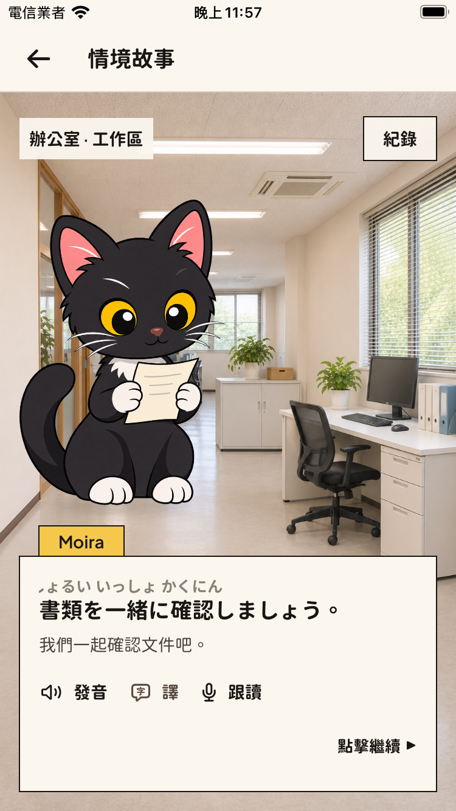
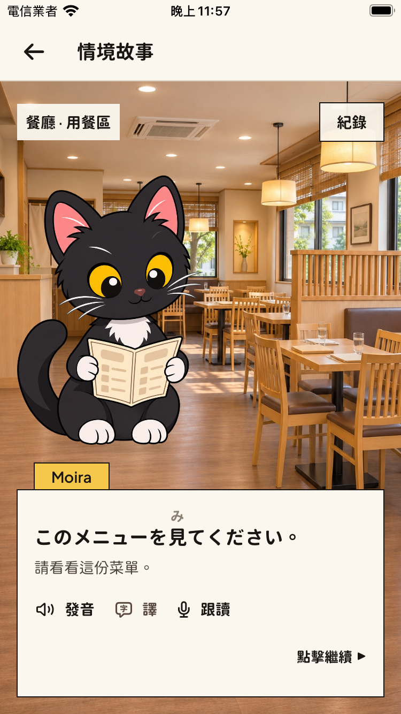
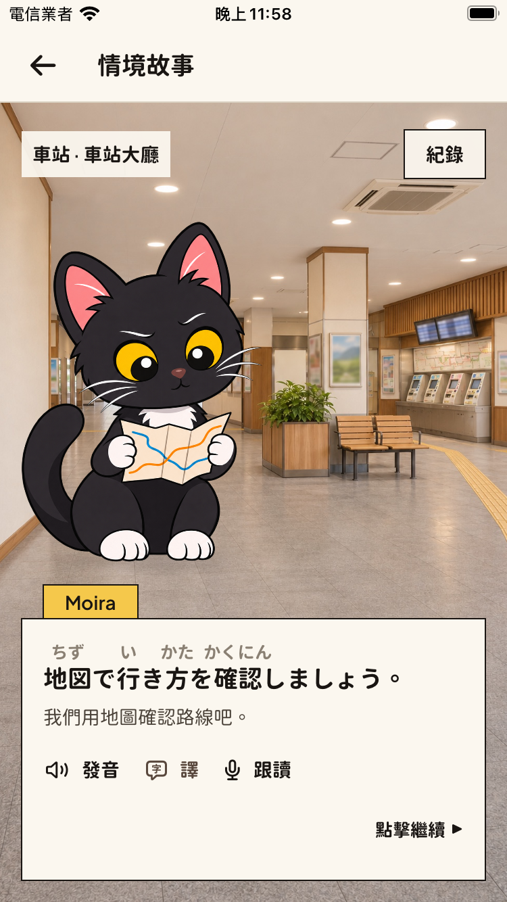
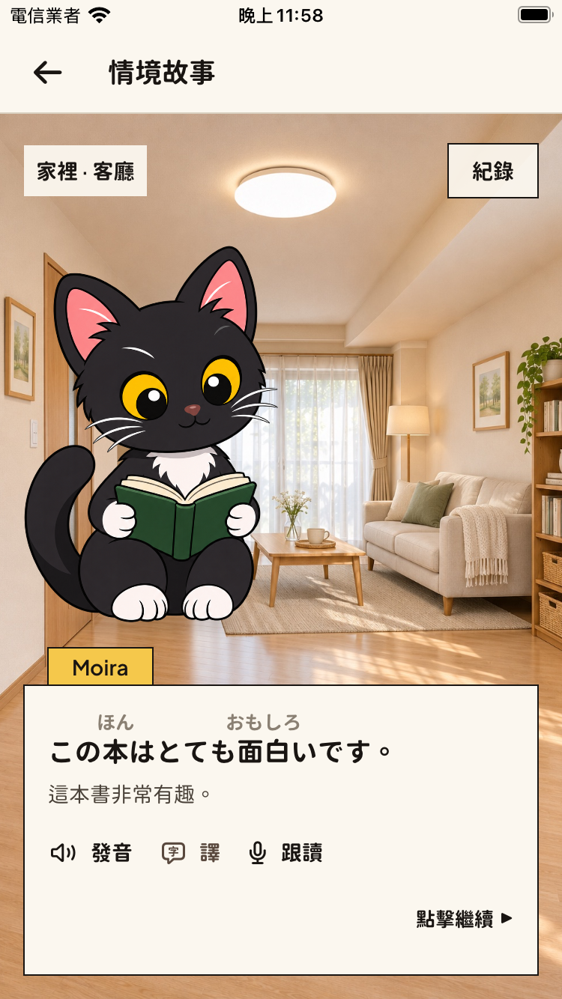

# Five-place stage visual review

Reviewed 2026-11-05–06 with Debug fixtures on iPhone SE (3rd generation, iOS 18) and iPhone 17 (iOS 26.4).

The four added places each have a general interior and three regions. The review checked all 16 new background compositions and all seven new prop silhouettes (document, laptop, menu, cup, ticket, map and book). Moira's ears, paws, tail and props remain visible above the measured dialogue at normal size. Office, restaurant, station and home use their own architecture and coherent regional views. The meeting-room image was revised to put the camera inside the room.

The SE review includes translation, Japanese furigana, every new region, and maximum accessibility text size in all four places. Icon controls remain reachable. Debug scroll-end probes show the end of long translated content while the controls stay fixed. Four iPhone 17 normal-size frames also confirm the layout. Existing supermarket fixtures were checked for regression. The complete 36-frame record and original imagegen sources/prompts are delivered in the task artifacts; representative frames are below.

| Office | Restaurant | Station | Home |
| --- | --- | --- | --- |
|  |  |  |  |

The shared interaction implementation retains the supermarket verification: tap to complete/advance, pronunciation replay, persistent translation, separate practice sheet with no automatic recording, and current-story transcript. No new interaction or microphone permission is introduced by a place.

The ending uses the same measured paper panel: three selected words and long notes scroll within the text area, while both restart/change actions stay visible, including at maximum accessibility size. The SE review includes normal, accessibility and scroll-end frames.

